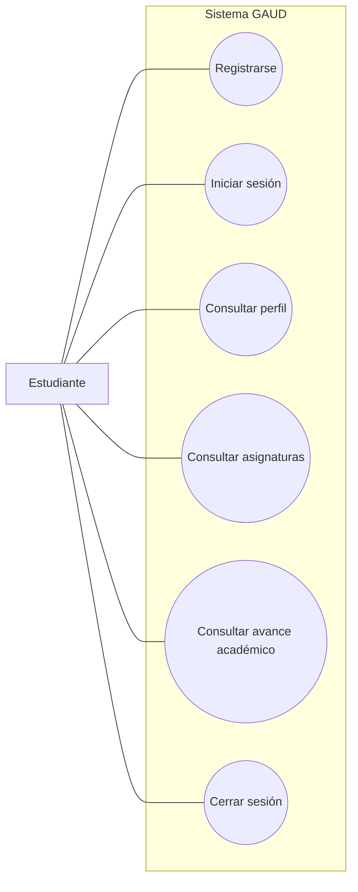
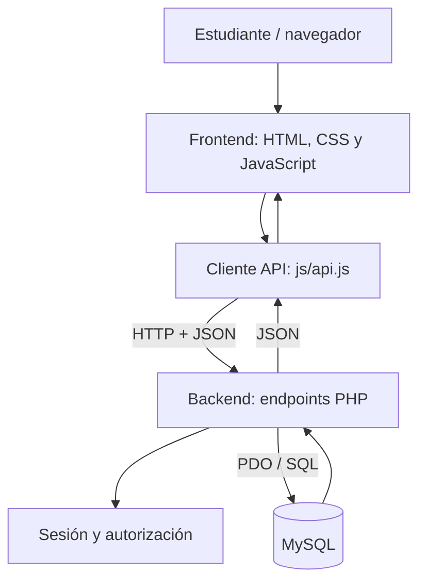

# Modelos UML — GAUD

Los diagramas siguientes representan el alcance conceptual de la versión en desarrollo. Deben contrastarse con el comportamiento real del código y actualizarse cuando cambien los requisitos.

## 1. Casos de uso



## 2. Componentes y comunicación



## 3. Modelo de datos conceptual


erDiagram
    UNIVERSIDADES ||--o{ CARRERAS : ofrece
    CARRERAS ||--o{ ASIGNATURAS : incluye
    UNIVERSIDADES ||--o{ USUARIOS : agrupa
    CARRERAS ||--o{ USUARIOS : pertenece
    USUARIOS ||--o{ INSCRIPCIONES : registra
    ASIGNATURAS ||--o{ INSCRIPCIONES : contiene

    UNIVERSIDADES {
      int id PK
      string nombre
    }
    CARRERAS {
      int id PK
      int universidad_id FK
      string nombre
    }
    ASIGNATURAS {
      int id PK
      string codigo
      string nombre
      int creditos
      int trimestre
      int carrera_id FK
    }
    USUARIOS {
      int id PK
      string nombre
      string email
      string password_hash
      int universidad_id FK
      int carrera_id FK
      string modalidad
    }
    INSCRIPCIONES {
      int id PK
      int usuario_id FK
      int asignatura_id FK
      string estado
      string calificacion
    }
```

## 4. Observaciones

- El modelo refleja las tablas principales observadas en `sql/gaud.sql`.
- La tabla `inscripciones` relaciona usuarios con asignaturas y registra un estado académico.
- Los diagramas son documentación de referencia; no sustituyen las pruebas ni una revisión completa de todos los flujos.
